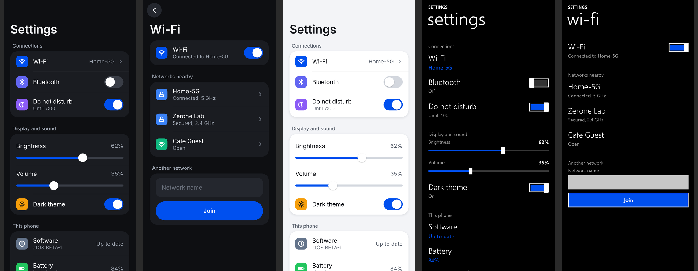

# zrn-sdk: design

The ztOS app platform, round 1: **libzrnui** (our own UI library, drawn on the
GPU), **zrnCoolStyle** (its default look), bindings for **C, C++, Rust and
Python**, the **.zexec** single-file app format, the **`zrn`** CLI, and the
store flow (moderated on Discord, built from source in CI). Written 30 October
2026. Everything here was built and run on the laptop; nothing has run on the
phone yet (see [What is not done](#what-is-not-done)).

## Contents

1. [Decisions in one page](#decisions-in-one-page)
2. [Why our own renderer](#why-our-own-renderer) (the comparison table)
3. [libzrnui](#libzrnui)
4. [zrnCoolStyle](#zrncoolstyle) and [Metro](#metro-ztretrofit)
5. [The API](#the-api)
6. [.zexec](#zexec)
7. [The zrn CLI](#the-zrn-cli)
8. [Coding agents](#coding-agents)
9. [The store](#the-store) and its [threat model](#threat-model)
10. [Round 2](#round-2)
11. [What is not done](#what-is-not-done)

## Decisions in one page

| # | Decision | Why |
|---|---|---|
| D1 | libzrnui is **new code with its own GLES2 renderer**, not ZrnMetroCore with a style table bolted on | ZrnMetroCore draws each page with Cairo/Pango into a raster that is uploaded whole; that upload on every content change is the known weak point ("GPU for everything"). Its Wayland/EGL setup, config keys, haptics and keyboard pipe were copied; the drawing was not. ztmetro is untouched. |
| D2 | Every widget is a **signed-distance rounded rectangle or a glyph**, batched into one vertex buffer | One shader, no tessellation, no stencil; corners, borders, lines and soft shadows are exact at any scale and under 3D transforms (Metro's tilt and turnstile). A frame is a few draw calls. |
| D3 | Text: **HarfBuzz** shapes in font units, **FreeType** rasterises each glyph once into a GPU atlas, **fontconfig** finds fallbacks | Layout is identical at every scale (laptop and phone agree); complex scripts (Sinhala, Tamil, CJK) shape correctly; no per-frame text rasterising. |
| D4 | A **retained tree** with automatic layout (page, section, card, column, row) and one callback shape | Easier than zmc's "draw a page, return its height, register hit boxes"; bindings only pass handles and closures; nothing redraws unless something changed. |
| D5 | **zrnCoolStyle is the default**; Metro is the second style over the same widgets; the user's choice (`ZUI_STYLE`, `zrnui_style` in the ztmetro config) wins over the app's | The brief. Styles differ in look and motion only, never in what the app writes. A DotMatrix session falls back to Metro until DotMatrix is ported (never mix). |
| D6 | **One C ABI**; C++ is a header-only wrapper; Rust is a hand-written `-sys` layer plus a safe crate; Python is ctypes | No bindgen, no cffi build step, no Qt. All four render identically (same library, same renders). |
| D7 | Fonts are **bundled**: Inter (zrnCoolStyle) and Selawik (Metro, Segoe UI's open metric twin), both SIL OFL 1.1 | The look must not depend on what fonts a phone happens to have. |
| D8 | **.zexec = `#!/usr/bin/env zrn-exec` line + a zip**, with a detached **minisign** signature | Runnable directly (the kernel's `#!`), but verified before any of it runs, with no architecture-specific stub inside every app. |
| D9 | The store **builds from source at a pinned commit**, approved by a **Discord moderator**, signed in a **separate CI job** that never runs app code | Strangers' binaries are never accepted; a repository changing after approval changes nothing. |
| D10 | Licence: **GPL-2.0-or-later** for libzrnui, the bindings and the tools (as ztmetro); **MIT** for examples and templates | Matches the code it came from. See the open question under [Round 2](#round-2): LGPL for libzrnui would let non-GPL apps link. |

## Why our own renderer

The brief suggested NanoVG or "an equivalent small vector layer". Assessed
against what a phone toolkit needs here: GPU drawing on GLES2 (the S9's Mali-G72
under Panfrost), full control of the look (two very different styles), Wayland,
touch, C plus three other languages, and a licence compatible with
GPL-2.0-or-later. Sizes and states are from the projects' own documentation as
known in October 2026, not measured here, except the last row.

| Option | Licence | Language, size | GPU path | Control of the look | Wayland, touch | Verdict |
|---|---|---|---|---|---|---|
| **NanoVG** | zlib | C, ~5k lines | GLES2: paths by stencil-then-cover, several passes per fill | full (it only draws) | none (bring your own) | Good fit for drawing, but text is fontstash + stb_truetype (no shaping: Sinhala would break), every rounded rect is a path with stencil passes, and upstream is unmaintained. We would still write the toolkit. |
| **LVGL** | MIT | C, a complete toolkit (~100k+ lines) | mainly its software renderer into buffers; GPU draw units exist (incl. OpenGL ES) but the widget look is designed around its own renderer | its own style system; making Metro's tilt and turnstile means fighting it | Wayland driver (SHM, EGL optional), touch yes | Strong on microcontrollers. Here it would mean CPU raster again, or an OpenGL path that is not its main road, and our styles inside its style model. |
| **Clay** | zlib | C99 single header, layout only (~4k lines) | none: emits draw commands | full | none | A layout engine, not a renderer. Our layout needs (columns, rows, cards) are a few hundred lines; a retained tree suits bindings better than an immediate-mode one. Could still be adopted later for complex layouts. |
| **microui / Nuklear** | MIT / public domain | C, ~1k / ~30k lines, immediate mode | command lists you render; GL backends exist | colours and sizes; a desktop-tool look | none / via backends | Immediate mode re-runs app code every frame (bad for Python and battery); no shaping; built for tool panels, not a phone look. |
| **Slint** | GPL-3.0 or royalty-free or commercial | Rust core with C++, Rust, JS and Python APIs; MBs at run time | FemtoVG (GLES), Skia or software | its own `.slint` language and styles | winit (Wayland), touch yes | Capable, but a Rust toolchain and a markup language for every app, GPL-3.0-only for the free licence (not compatible with GPL-2.0-only code), no C API, and our styles would be re-implemented in its language. |
| **GPUI** (Zed) | Apache-2.0 | Rust only | since February 2026 on Linux through **wgpu** | full, in Rust | desktop-oriented; no evidence of touch input | **Rejected as the system UI**: wgpu wants Vulkan and the S9's Mali-G72 has no Vulkan driver installed (mesa 26.2.5 on the phone, no vulkan-panfrost; PanVK support for Bifrost v6 unconfirmed); Rust-only (no C or Python); API unstable. A GPUI app could still ship as a `.zexec` later if wgpu's GLES backend works on Panfrost (unverified). |
| **Own SDF batcher (chosen)** | GPL-2.0-or-later (ours) | C: 470 lines (gfx.c) + 490 (text.c); libzrnui as a whole about 4,400 lines, 124 KB stripped on x86_64 | GLES2: one shader, one streamed vertex buffer, a few draw calls per frame; glyphs uploaded once | full: every widget's look is a style function | our Wayland client (from ZrnMetroCore), touch, pointer, keyboard | Smallest thing that gives exact rounded shapes, borders, shadows, lines and 3D transforms on GLES2 with real text shaping. |

## libzrnui

```
libzrnui/
  include/zrnui.h      the C API (everything an app uses)
  include/zrnui.hpp    C++ wrapper, header only
  src/core.c           tree, layout, touch/scroll/fling, pages and transitions, drawing a frame
  src/gfx.c            the GPU batcher (SDF shapes, glyph atlas, transforms)
  src/text.c           HarfBuzz + FreeType + fontconfig, line breaking, ellipsis
  src/style-cool.c     zrnCoolStyle
  src/style-metro.c    Metro (ZrnMetroCore's numbers)
  src/icons.c          20 line icons drawn as strokes
  src/wl.c             Wayland window, EGL, input, the main loop
  src/offscreen.c      EGL surfaceless + FBO + PNG (renders without a display)
  fonts/               Inter and Selawik, with their OFL licences
  protocol/            xdg-shell (copied from ztmetro/core)
```

**Drawing.** Each frame the visible part of the tree is walked and every widget
emits quads. A quad's corners carry their position *inside the shape*; the
fragment shader computes the signed distance to a rounded box and turns it into
coverage (fill, outline, or a soft shadow). Lines are thin rotated rounded
boxes; arcs are short lines. Text quads sample an 8-bit coverage atlas
(2048x2048) filled by FreeType on first use. Colours are premultiplied, so one
blend mode covers everything. Transforms (a 4x4 matrix per row or widget) are
applied to the corners on the CPU and the GPU does the perspective divide, so
Metro's turnstile and tilt and zrnCoolStyle's slides use the same path. Scissor
clips the list under the fixed header.

**When it draws.** Only when something changed or is moving (a transition, a
fling, a spring, a switch's knob, a toast, an indeterminate bar), paced by the
compositor's frame callbacks; otherwise the process sleeps in `poll`. The
caret does not blink, so a focused field costs nothing at rest.

**Scale.** Layout is in points. The pixel scale is `ZUI_SCALE`, else the
shell's `ZTMETRO_SCALE` (4 on the S9: 1440x2960 pixels is 360x740 points),
else the compositor's preferred buffer scale, else the output's.

**Threads.** One UI thread; `zui_post` is the way in from others (an eventfd
and a locked queue). One app per process: fonts and glyphs are per process.

**System settings read.** The accent (`accent = cobalt` in
`~/.config/ztmetro/config`, ztmetro's 20 named colours, or `#rrggbb`), style
(`zrnui_style = cool|metro|follow`), theme (`zrnui_theme = dark|light`), the
session's `ZTRF_SHELL_STYLE`. Haptics and the on-screen keyboard go to the
shell's control pipe (`$XDG_RUNTIME_DIR/ztmetro.ctl`) exactly as ZrnMetroCore
sends them (`haptic tap`, `osk show <bottom>`).

## zrnCoolStyle

Calm, readable, modern; dark by default (OLED), with a light theme.



| | dark | light |
|---|---|---|
| page | `#0E0F12` graphite | `#F3F4F7` paper |
| card | `#1A1C21`, no shadow | `#FFFFFF`, 10 pt soft shadow |
| text / secondary / tertiary | `#F2F3F5` / `#9AA1AC` / `#666C77` | `#14161B` / `#5D6470` / `#9AA0AA` |
| dividers | white 8 %, hairline, inset to the text | black 9 % |
| accent | the system's; lifted toward white for text on dark when it is dark (cobalt stays readable) | the system's, slightly darkened for text |

- **Type**: Inter. Page title 32 pt semibold; body 16; row titles 16 regular;
  secondary 13.5; section labels 13.5 medium; line height 1.36.
- **Shape**: cards 20 pt radius; buttons and switches are pills (52 pt tall
  buttons, 52x32 switches with a 26 pt knob); fields 52 pt, 14 pt radius;
  icon tiles 32 pt, 9 pt radius, tinted per row.
- **Space**: 18 pt page margin, 16 pt between groups, 16 pt inside cards;
  rows 56 pt (68 with a second line): every target is finger-sized.
- **Header**: a large title scrolls with the page; a 56 pt bar on top fills in
  and shows the small title once the large one has gone; a round back button
  when the page is not the first.
- **Motion**: a press dims a row (inset pill highlight) or sinks a button 3.5 %;
  pages *fade through* in 380 ms (the old page is gone in the first third
  while drifting back 4 %, the new one slides in from 16 % with its rows 14 ms
  apart, eased with a quick start and a long settle); switches slide 180 ms;
  the busy bar sweeps under the top bar. Nothing moves that the finger did not
  start.

Renders (offscreen, the real GPU path, 1440x2960 at scale 4):
`docs/renders/cool-settings.png`, `cool-settings-scrolled.png`,
`cool-wifi.png`, `cool-light-settings.png`, `cool-light-wifi.png`; the
transition in a real compositor: `docs/renders/kwin-cool-0..4.png`.

### Metro (ztRetrofit)

The same widgets as ZrnMetroCore draws them: black, white Selawik (Segoe UI's
open twin), the app's name in capitals over a 48 pt lowercase title fixed at
the top (108 pt), 21 pt semilight row titles with a grey or accent second
line, rectangular toggles, outlined buttons that fill white when pressed, the
tilt on press (14 degrees toward the finger, the far edge lifting at most
40 pt, a 4.5 % sink) and the turnstile between pages (rows turn out round the
left edge 128 ms each 28 ms apart, black, then the new rows swing in from
behind in 180 ms). Numbers are ZrnMetroCore's. Renders:
`docs/renders/metro-settings.png`, `metro-wifi.png`, `kwin-metro-1..4.png`.

## The API

The C API is `libzrnui/include/zrnui.h`; the same names exist in C++
(`zrnui.hpp`), Rust (`rust/`, crate `zrnui`) and Python (`python/zrnui`).

```c
zui_app *app = zui_app_new("io.github.you.notes", "Notes");
zui_node *page = zui_page(app, "Notes");
zui_node *list = zui_section(page, "Recent");            /* a heading and a card */
zui_node *row = zui_item(list, "Shopping", "3 items", open_note, note);
zui_set_icon(row, "check");
zui_switch(zui_section(page, "Sync"), "Back up notes", true, sync_changed, NULL);
zui_button(page, "New note", new_note, NULL);
return zui_run(app, page);
```

- Containers: `zui_page`, `zui_section` (returns the card), `zui_card`,
  `zui_column`, `zui_row` (with `zui_set_flex`), `zui_space`.
- Things: `zui_text`, `zui_heading`, `zui_caption`, `zui_button` (+ variant
  primary/tonal/plain/danger), `zui_item` (title, subtitle, detail on the right,
  icon, arrow when it has a callback), `zui_switch`, `zui_slider`,
  `zui_progress` (determinate or not), `zui_field`.
- One callback shape, `void cb(zui_node *, void *data)`; `zui_event(node)` says
  click, change or submit. `zui_set_handler(node, cb, data, free_data)` lets
  bindings free their closures with the node.
- Navigation: `zui_push(page)`, `zui_back(app)` (the hardware Back, Escape, the
  back button, and in Metro a tap on the title all go back; back on the first
  page closes the app).
- Main loop: `zui_timer`, `zui_watch_fd`, `zui_post` (thread-safe), `zui_busy`,
  `zui_toast`, `zui_haptic`.
- Without a display: `zui_render_png`, `zui_layout`, `zui_inject_touch`,
  `zui_inject_text` (tests); `ZUI_RENDER_PNG=out.png` makes any app draw its
  first page (or `ZUI_RENDER_PAGE`) and exit; `ZUI_SCRIPT="wait 500; tap 180
  300; type hi; snap a.png; back; quit"` drives a running app.

Bindings: C++ adds RAII (`App` frees everything) and lambdas; Rust ties every
`Node<'a>` to its `App` by lifetime, boxes closures and drops them with the
node, and gives other threads a `Poster` that stops posting once the App is
gone; Python keeps callbacks in a table keyed by the C data pointer and
forgets them when the node is freed.

## .zexec

```
#!/usr/bin/env zrn-exec\n      24 bytes: chmod +x and run it; the kernel hands it to zrn-exec
<zip archive>                   offsets absolute, so `unzip -t` and Python both read it
  zexec.json                    the manifest, first, stored
  icon.svg | icon.png
  bin/<id>                      native: the program (ELF for the manifest's arch)
  lib/                          optional shared libraries (LD_LIBRARY_PATH), e.g. a bundled libzrnui
  share/                        data files; share/zrnui/fonts with a bundled libzrnui
  app/                          python3: the sources; entry is app/<file>
  python/zrnui/                 optional bundled Python binding
<file>.zexec.minisig            detached minisign signature (Ed25519 over BLAKE2b-512)
```

The manifest (`zexec.json`):

| field | what |
|---|---|
| `zexec` | format, `1` |
| `id` | reverse-DNS with three or more parts (`io.github.alice.notes`), or `zrn-name` (reserved for Zerone Laboratories). Also the Wayland app_id and the desktop id. |
| `name`, `summary`, `description`, `author`, `licence`, `homepage`, `categories` | for the app list and the store |
| `version` | semantic version |
| `arch` | `aarch64`, `x86_64`, or `any` (Python) |
| `runtime` | `native` or `python3` |
| `entry` | path inside the package |
| `icon` | `.svg` or `.png` inside the package |
| `zrnui` | the libzrnui ABI it was built against (`0.1`) |
| `min_ztos` | lowest ztOS it runs on |
| `permissions` | declared needs: `network`, `audio`, `camera`, `location`, `notifications`, `bluetooth`, `phone`, `contacts`, `messages`, `background`, `files.music`, `files.pictures`, `files.documents`, `files.downloads` (declared only in round 1; see Round 2) |
| `source` | `{repo, commit}`: set by the store's CI |
| `bundles` | `["zrnui"]` when libzrnui is inside |
| `built` | `{by, lang}` |

**Signature.** minisign's format, so `minisign -V` can check it (the format is
followed from its specification; there was no minisign binary on the laptop
to cross-check against). The trusted comment binds the file to its manifest:
`zexec id=<id> version=<v> arch=<a> sha256=<hex>`, and verification fails if
those differ from the manifest or the file. Keys: `~/.config/zrn/keys/*.key`
(0600, unencrypted, minisign `-W` layout); trusted public keys in
`/etc/zrn/trusted-keys`, `/usr/share/zrn/trusted-keys` and
`~/.config/zrn/trusted-keys`.

**Running.** `zrn-exec` checks structure and signature before anything in the
package runs, records the result for that exact file (inode, size, mtime), and
unpacks once into `~/.cache/zrn/apps/<id>/<sha256>`; what the app prints goes to
`~/.local/state/zrn/<id>.log` (the previous run in `.log.1`). A package that
is broken or not trusted is not started and the shell is told
(`notify Name|Not trusted|...`).

**Why not the current SDK's ELF launcher + appended zip.** That puts an
aarch64 stub in every app (each carrying its own copy of launcher bugs), runs
code from the package before anything could check it, and needs a stub per
architecture. A `#!` line costs nothing, keeps the file directly runnable, and
leaves verification to one trusted program on the system. Packing is
reproducible (sorted names, fixed times and modes): building the same commit
twice gives the same bytes, which lets anyone check the store's builds.

**Install.** `zrn install app.zexec` (refuses broken or untrusted packages):
`~/.local/share/zrn/apps/<id>/<id>.zexec` (+ `.minisig`), the icon in
`~/.local/share/icons/hicolor/{scalable,256x256}/apps/<id>.*`, and
`~/.local/share/applications/<id>.desktop` with `Exec=zrn-exec <path>`,
`StartupWMClass=<id>` and `X-Zrn-Id`/`-Version`/`-Sha256`; then `apps` down
the shell's control pipe, as `ztos-sdk install` does.

## The zrn CLI

`tools/zrn` (Python 3.11+, no dependencies; uses `python-cryptography` when
present, else a pure-Python Ed25519).

| command | does |
|---|---|
| `zrn new NAME --lang c\|cpp\|python\|rust [--id ID]` | a project from `templates/`, with `AGENTS.md` |
| `zrn build` | C/C++ with the system's or the SDK's libzrnui (builds it if needed); Rust with cargo; Python is syntax-checked |
| `zrn render [--page N\|TITLE] [--style] [--theme] [--scroll Y] [--size WxH] [--scale S] out.png` | the real GPU path, offscreen; for people and agents to look at a screen |
| `zrn run [--headless] [--script ...]` | in the session's Wayland display, else a nested compositor (weston or kwin_wayland; `--headless`: a virtual one) |
| `zrn pack [--bundle-zrnui] [--key K] [--no-sign]` | `dist/<id>-<version>-<arch>.zexec` + `.minisig` (makes a dev key on first use and trusts it for this user) |
| `zrn verify FILE` | exit 0 good, 1 broken, 2 not trusted |
| `zrn install FILE`, `zrn uninstall ID` | for this user |
| `zrn submit` | the store entry for HEAD (dry run; `--send` posts it) |
| `zrn keygen`, `zrn info FILE`, `zrn doctor`, `zrn exec FILE`, `zrn init-agents` | |

Every command takes `--json` (one object on stdout; errors as
`{"ok": false, "error": {"code", "message", "hint"}}`), and every error names
the file or value and the fix. Exit 3 is a usage error.

## Coding agents

The SDK is meant to be used by coding agents as much as by people.

- `zrn init-agents` (a picker; or `--agent claude,codex` / `--all`) writes one
  shared instruction text (`templates/agents/INSTRUCTIONS.md`) as each agent's
  file and installs the **zrnui skill** (`templates/agents/SKILL.md`, with
  `name`/`description` frontmatter) where each agent looks for skills. It
  writes only into an app's own folder (one with `zrnapp.toml`).

  | agent | instructions | skill |
  |---|---|---|
  | Claude Code | `CLAUDE.md` | `.claude/skills/zrnui/` |
  | Codex | `AGENTS.md` | `.agents/skills/zrnui/` |
  | Gemini CLI | `GEMINI.md` | `.gemini/skills/zrnui/` |
  | Cursor | `.cursor/rules/zrnui.mdc` | `.cursor/skills/zrnui/` |
  | GitHub Copilot | `.github/copilot-instructions.md` | `.github/skills/zrnui/` |
  | OpenCode | `AGENTS.md` | `.opencode/skills/zrnui/` |
  | Antigravity | `.agent/rules/zrnui.md` | `.agent/skills/zrnui/` |
  | Windsurf | `.windsurf/rules/zrnui.md` | `.windsurf/skills/zrnui/` |

  These paths follow each tool's documented conventions as known in October
  2026; skill folders for Cursor, Windsurf and Gemini are the least certain.
  They live in one table (`tools/zrnlib/agents.py`).
- The skill teaches the API in all four languages, the zrnCoolStyle rules, the
  project layout, `zrn build/run/pack/verify`, and how to check visuals with
  `zrn render` and `zrn run --headless --script`.
- `zrn new` templates ship with `AGENTS.md`; `docs/llms.txt` indexes the SDK.

## The store

Repository: Zerone-Laboratories/ztOS-apprepo (staged locally as
`zrn-apprepo`). Moderated on the ztOS Mobile Discord, reusing the device-list
pattern (`ztOSMobile/services/device-submit`: a Cloudflare Worker, a bot that
opens a forum post with Accept/Reject buttons for moderators, Accept commits
with a fine-grained token).

1. **Submit.** The author pushes the app to a public GitHub repository and
   sends id, repo URL, full commit SHA and subfolder: `zrn submit --send`, the
   store page's form, or the bot's `/submit-app` command. The Worker
   (`services/app-submit`) checks the commit exists, reads `zrnapp.toml` *at
   that commit* (id and version must match), and opens a post in
   **#ztos-app-submissions** with the manifest, the permissions asked for, a
   link to the exact tree, and (for an update) a compare link from the last
   approved commit.
2. **Review.** Only moderators (Manage Threads) can press **Accept** or
   **Reject** (Reject asks for a reason and locks the post).
3. **Accept** commits `ledger/<id>.toml` (a new `[[release]]` with version,
   commit, the moderator's Discord id and name, time, thread) and sends a
   `repository_dispatch` (`app-approved`).
4. **CI** (`publish.yml`): *plan* lists approved releases with no published
   asset; *build* (one job per release and arch, `permissions: {}`, no secrets)
   fetches the repo **at the pinned SHA** (never a branch), checks the commit,
   id and version, and runs `zrn pack --no-sign`; *publish* (the only job with
   the store key, in a protected environment) checks each artefact's
   structure and that its manifest's id, version, arch and `source.commit`
   match the ledger, signs it, uploads `.zexec` + `.minisig` to the release
   `<id>-<version>`, regenerates `index.json` (+ `.minisig`) and pushes it to
   the `store-index` branch. Only approved, signed releases appear.
5. **Clients** (ztstore, round 2) trust only the store key: they refuse an
   index or a package whose signature does not verify, whose sha256 differs
   from the index, or whose trusted comment names another id/version/arch.
6. **Revoke.** A moderator presses **Revoke** on the accepted post (or
   `/revoke-app id version reason`): the ledger marks the release revoked (who,
   when, why), CI drops it from `apps` and lists it under `revoked` with its
   sha256; clients disable an installed copy and say why.

An update is a new submission with a new commit and needs a new approval.

### Threat model

| Threat | Answer |
|---|---|
| A malicious build script (`build.rs`, a Makefile, a setup step) | The build job has no secrets and no token (`permissions: {}`), runs on a throwaway runner, and only hands over an artefact. The signing job never executes anything from the package; it reads the zip and checks it. A malicious *app* is a review question, not a CI one: moderators see the permissions and the source link. |
| The repository changes after approval (force-push, new commits, deleted history) | CI fetches the exact SHA and checks `git rev-parse HEAD`; the ledger holds the SHA, not a branch or tag. A force-push that removes the commit makes the build fail, not change. |
| A moderator account is taken over | Every approval records the moderator's Discord id in the ledger (in git history); revocation is one button; the Worker only accepts interactions signed by Discord and from members with Manage Threads. |
| The Worker's GitHub token leaks | Fine-grained, this repository only, Contents read/write (and dispatch). It can write the ledger, so it could approve something: the publish job therefore also requires that the release's commit message was made by the bot and (recommended) a GitHub environment with required reviewers for the signing job. It cannot read the store key. |
| The store key leaks | Only the publish job reads it (environment secret). Recovery: a new key, ztstore update with both keys during rotation, re-sign the current releases, revoke the old key in clients. Keep an offline copy of the key; never on a laptop that builds apps. |
| A swapped or downgraded package on a mirror | The signature binds id, version, arch and sha256; the signed index binds each release's sha256 and URL; clients refuse anything else. |
| A stranger uploads a binary | There is no path for it: the store only ever builds. |
| Typo-squatting ids | `zrn-` ids are reserved; moderators check new ids; an id belongs to the repository first approved for it (an update from another repo is flagged in the post). |

## Round 2

In order of value:

1. **libzrnui on the phone**: build it on the phone (or the workstation's
   aarch64 tree), package it (`/usr/lib/libzrnui.so.0`, `/usr/share/zrnui`,
   `/usr/bin/zrn-exec`, `/usr/share/zrn/trusted-keys/store.pub`), and measure:
   frame time and CPU per frame on the four efficiency cores against
   ZrnMetroCore's Settings (the "optimise for nominal" rule), glyph atlas
   upload cost, first-frame time. Until then `zrn pack --bundle-zrnui`.
2. **ztstore source "ztOS apps"**: read `index.json` from the `store-index`
   branch (verify with the store key compiled in), show apps with name,
   summary, permissions and source link; install = download `.zexec` and
   `.minisig`, verify signature and sha256 against the index, then what
   `zrn install` does; updates when the index has a newer version for the same
   id; revoked releases disabled with the reason. Same pacman/AUR UI.
3. **Permissions enforced**: run `.zexec` apps under bubblewrap or Landlock
   with only what `permissions` declares (network namespace, the files.*
   folders, the PipeWire socket for audio, the GNSS/IAL D-Bus names).
4. **Migrate ztmetro apps** to libzrnui one by one (Power first: small, then
   Settings), keeping Metro as the style so nothing changes for the user until
   they pick zrnCoolStyle; compare frame cost before and after on the phone.
   Missing for them: pivots (tabs that swipe), list pickers, menus on hold,
   round buttons, the custom overlay and DMA-BUF hooks (camera, browser).
5. **Port Music** (`apps/music`, Python SDK + Qt) to `zrnui` in Python:
   yt-dlp and mpv out of process as now, `app.watch(fd)` for mpv's IPC socket,
   `app.post()` from the worker thread. Needs images (album art): add
   `zui_image` (PNG/JPEG into a texture).
6. **DotMatrix** as the third style (ztRetrofit: never mixed), from
   `ztmetro/retro`.
7. **aarch64 builds in CI** (`ubuntu-24.04-arm`, already in `publish.yml`) and
   on the laptop (a cross toolchain and an Arch Linux ARM sysroot).
8. Widgets: images, lists of thousands (virtualised), pivots/tabs, dialogs,
   menus, pickers, date/time, pull to refresh, bidirectional text,
   accessibility (screen reader names on nodes).
9. **Licence question for the owner**: LGPL-2.1-or-later for libzrnui and the
   bindings would let apps under any licence link; today GPL-2.0-or-later means
   every native store app must be GPL-compatible.

## What is not done

- Nothing ran on the phone (a sleep bench is running on it; by instruction).
  Performance on the Mali-G72 is inferred from the design (a few draw calls,
  no per-frame raster), not measured.
- No aarch64 build: there is no cross compiler on the laptop; every `.zexec`
  made here is x86_64 (or `any` for Python).
- `zrn run` without `--headless` (a visible nested window on the X11 desktop)
  was not tried, to keep windows off the user's screen; `--headless` in
  kwin_wayland's virtual backend was.
- The minisign format was not cross-checked with the `minisign` binary (not
  installed); Ed25519 itself is checked against RFC 8032 and python-cryptography.
- The store Worker, Discord commands and workflows are written and
  syntax-checked, not deployed or run on GitHub; the store pipeline was run
  locally end to end (see zrn-apprepo/evidence).
- Permissions are declared, not enforced. No images, pivots, menus or
  virtualised lists yet. Bidirectional text is not reordered.
