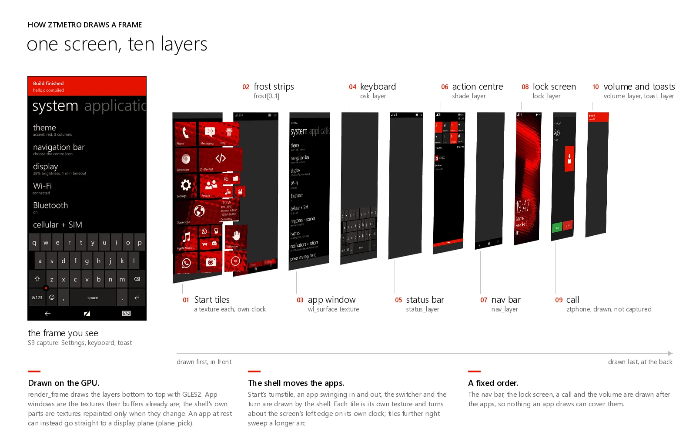

# How the shell draws

ztMETRO is the ztOS Mobile shell and its Wayland compositor in one program. Every frame it draws the whole screen in one GLES2 pass, layer by layer, bottom to top, in a fixed order. Your app's window is one of those layers. This page says what the layers are, in what order they are drawn, and what that means for an app.

<picture>
  <source media="(prefers-color-scheme: dark)" srcset="img/shell-layers-dark.webp">
  
</picture>

The layers are screenshots of ztMETRO on a Galaxy S9, cut apart along the shell's own lines; layer 01, painted first, is in front, and Start is cut into its tiles, because each tile is its own texture that turns about the screen's left edge on its own clock. Wi-Fi and carrier names are covered and the action centre's notification is replaced with a demo one. The call screen is drawn with zrnui, not captured. The picture is generated by `gen/layers.py` in [zrn-sdk-site](https://github.com/Zerone-Laboratories/zrn-sdk-site). The order and the names below come from `render_frame` in `ztmetro/ztmetro.c` of ztOSMobile, read on 21 November 2026. When the shell changes, check them again.

## The order, bottom to top

A later layer covers an earlier one. The numbers are the picture's; a dash marks a step that is not in it.

| # | Layer | What the shell draws | In the code |
|---|---|---|---|
| – | Background | The screen cleared to the shell background (white in Light, black in Dark). Only the gaps between Start's tiles show it. | `glClear`, `shell_bg_color` |
| 01 | Start and the app list | The tiles, each its own texture: for the turnstile each turns about the screen's left edge on its own clock; tiles further right sweep a longer arc (clocks by row from the bottom, small tiles early, the top-left last, a little jitter). And the list beside them. Not drawn while an app at rest or the lock screen covers them. | tiles, items; skipped on `app_covers`, `lock_covers` |
| 02 | Frost strips | What of Start and the list passes under the status bar and the nav bar, blurred into two strips right after Start is drawn, and blurred again only when that changes. Each strip is laid just under its own bar (05 and 07), as its backing. Over an app the bars are opaque and there is no frost. | `frost_prepare`, `frost[0]`, `frost[1]` |
| 03 | App window | The app's buffer, already a GPU texture, drawn as a quad between the bars. Or the switcher's cards, or the launch flip in landscape. | `draw_app_surface` |
| – | Hyperscan | The shell's search page, when it is up. | `hyper_layer` |
| 04 | Keyboard | The on-screen keyboard, sliding up from the nav bar. | `osk_layer` |
| – | The turn | While the screen rotates, a picture of the old layout over the new one. | `rot_snapshot_draw` |
| 05 | Status bar | Signal, battery, clock; the charging plug; the taller row you get by holding it. | `status_layer`, `plug_layer`, `peek_layer` |
| 06 | Action centre | The panel pulled down from the top: quick actions and notifications. | `shade_layer` |
| 07 | Nav bar | Back, Start, search. After the action centre, so the panel comes down behind it. | `nav_layer` |
| 08 | Lock screen | Its picture, clock and notification row. Opaque: while it is fully down, Start and the apps under it are not drawn; while it slides, only the strip below it is. | `lock_layer` |
| 09 | Call | The phone app's window (`ztphone`) drawn again over the lock, with the status row over it. | `call_over_lock` |
| 10 | Volume, toasts, dialogs | The volume banner and a notification toast in the same place at the top, and the shell's dialogs. | `volume_layer`, `toast_layer`, `dialog_layer` |

The boot splash is left out too. One exception to the single pass: when an app is at rest and fills its area, the shell may hand its buffer straight to a display plane (`plane_pick`) instead of drawing it, when the display hardware accepts it.

## Textures, and what is drawn each frame

- **App windows** are textures already. The shell takes the buffer from Wayland and draws it; it does not copy it.
- **The shell's own layers** (the bars, the keyboard, the action centre, the lock screen, the banners, each tile) are painted once into a texture and uploaded again only when what they show changes.
- **Each frame** the shell only places those textures, a quad each, with the position, turn and fade of the moment. The frost strips are blurred on the GPU only when what is under the bars changed (every frame only while the screen turns); the call's frosted backdrop is the other blur.

## The shell moves the apps

Every app is a layer of the same frame, so the shell animates going between them: Start's tiles turning away and an app swinging in (the turnstile), an app swinging out on Back, the switcher, the launch flip in landscape and the turn of the screen. Every app arrives and leaves the same way, and needs no code for it.

## What it means for your app

- **Your window is one textured layer.** Draw your whole page into it. The shell draws nothing inside it.
- **Your app bar is yours; the keyboard is the shell's.** zrnui draws the app bar (`Zpage_set_bottom_app_bar`) inside your window. The on-screen keyboard is a shell layer over your window; zrnapp passes its height to zrnui (`Zroot_set_input_pane_height`) and your page makes room for it.
- **Frost samples what is under it.** The shell's frost blurs only Start and the list under its bars. A frosted element in your app (`Zelement_set_frosted_diffusion`) blurs what your own page drew under it, never another app or the shell.
- **Calls, the nav bar and the volume stay on top.** Nothing your app draws can cover them, and you need not leave room for the volume banner or a toast.
- **You do not animate your arrival.** Launch, Back and the turn are the shell's. Page transitions inside your app (the turnstile between pages, the pivot) are zrnui's.
